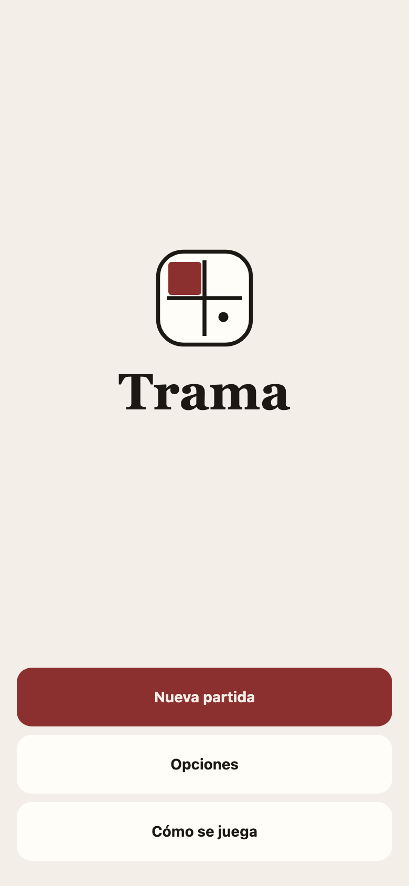
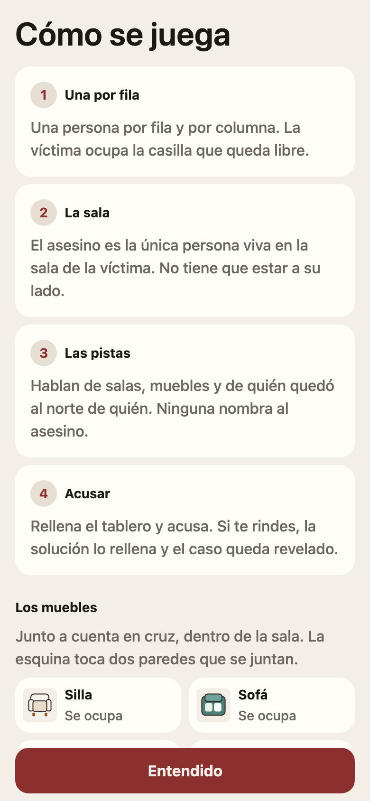
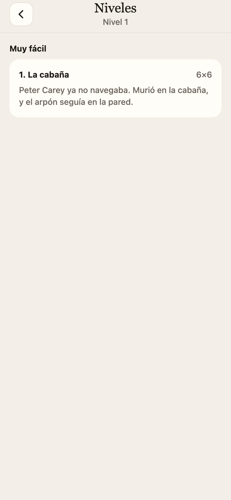
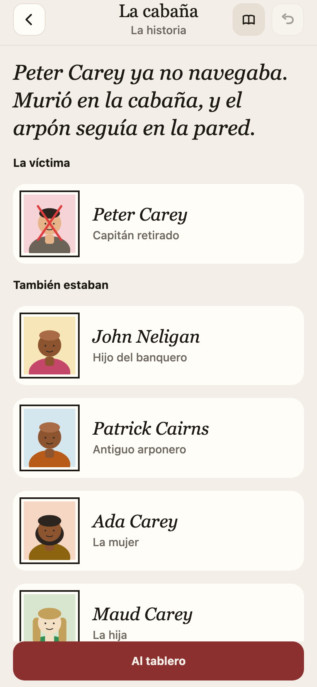
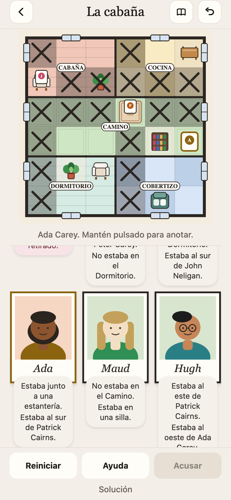
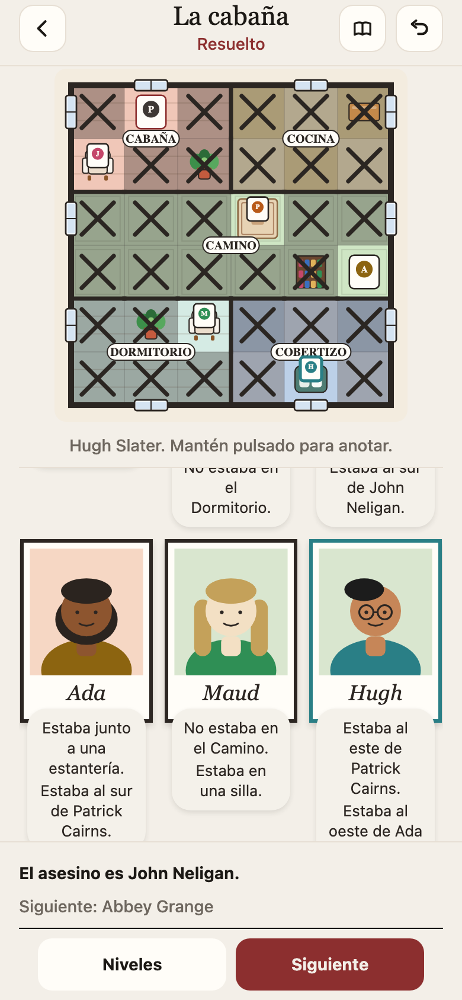
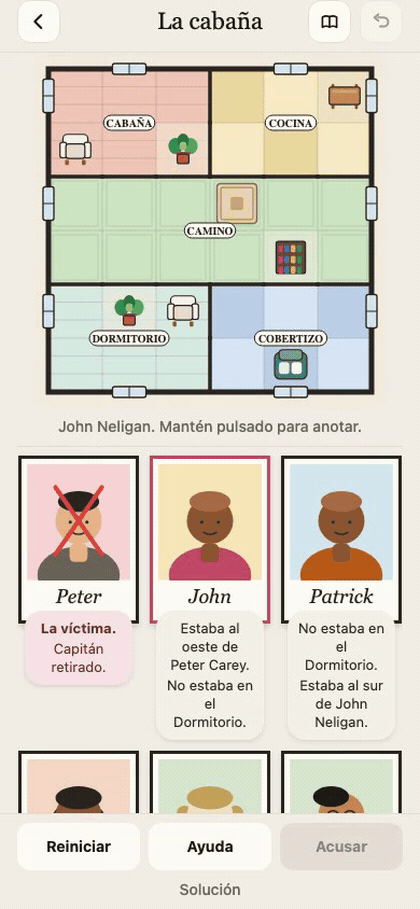
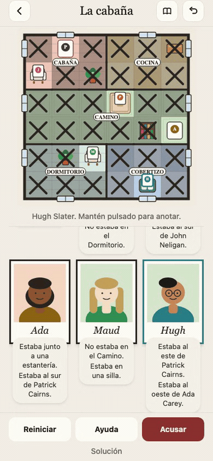

# Trama

Puzzle de lógica para iOS y Android. Coloca a los sospechosos, uno por fila y columna, y deduce quién se quedó a solas con la víctima.

<p align="center">
  
  
  
</p>
<p align="center">
  
  
  
</p>





Vídeo para LinkedIn, vertical 1080×1920, 28 s: [docs/media/trama.mp4](docs/media/trama.mp4). Resuelve el primer caso.

Sin anuncios, sin cuentas y sin red: los casos van dentro de la app. El texto de privacidad está en la app, en Opciones. Las tiendas piden además una URL pública con ese mismo texto.

```bash
npm install
npm test
npm run check-cases
npx expo start
```

El nombre de tienda y el bundle id (`com.mun0n.caso`) están en `app.json`.
